# Metric Detective 🔍 — AI Root-Cause Analyst


> **"When a business KPI changes, analysts spend hours slicing data to find WHY. Metric Detective automates this end-to-end: detect anomaly → AI proposes hypotheses → AI writes SQL → engine runs SQL + statistical tests → verifier audits every claim against raw numbers → AI writes an evidence-backed report."**

---

## 1. Problem Statement
When core e-commerce KPIs (revenue, order volume, cancellation rates, delivery delays, review scores) experience sudden drops or spikes, analysts manually slice data across regions, categories, sellers, and payment types. 

**Metric Detective** turns this tedious workflow into an autonomous, rigorous investigation:
- **Core Principle (Non-Negotiable):** The LLM **NEVER** invents numbers. The LLM only proposes hypotheses, writes analytical SQL queries, and crafts narrative summaries. Every number cited in the final report is audited by an automated verification agent against executed query results.

---

## 2. Architecture

```mermaid
flowchart LR
    A["KPI Monitor\n(DuckDB)"] --> B["Anomaly Detection\n(STL + Robust Z-Score)"]
    B --> C["Contribution Analysis\n(Mix vs. Rate Slicing)"]
    C --> D["Hypothesis Agent\n(Multi-Step Causal AI)"]
    D --> E["SQL Agent & Guard\n(Read-Only + LIMIT + Timeout)"]
    E --> F["Statistical Tests\n(t-test / z-test / Chi-square)"]
    F --> G["AI Verifier\n(Audit Numbers ±1% Tolerance)"]
    G --> H["Reporter Agent\n(Evidence-Backed Narrative)"]
    H --> I["Report & Evidence Store\n(Markdown + JSON)"]
```



---

## 3. Key Features
- **Deterministic Statistical Backbone:** Weekly seasonal STL decomposition combined with median absolute deviation (MAD) robust z-scores (|z| > 3.0).
- **Dimension Slicing & Contribution Analysis:** Mathematical attribution for additive metrics (`delta_segment / delta_total`) and mix vs. rate decomposition for ratio KPIs.
- **Audited SQL Agent with Safety Guard:** Strictly enforces read-only `SELECT`/`WITH` queries, adds `LIMIT 1000`, enforces 20s timeouts, and blocks DDL/DML. Self-corrects on errors (up to 3 retries).
- **Statistical Significance Engine:** Welch's t-test for means, two-proportion z-tests for rates, and Chi-square contingency tests with effect sizes and 95% confidence intervals.
- **Zero-Hallucination Verifier:** Regex extraction scans generated narrative text against query outputs. Unverified claims or discrepancies are rejected and sent back for automated correction.
- **Provider-Agnostic LLM Client:** Swappable between Google Gemini, OpenAI, and Groq with full token and cost telemetry.

---

## 4. Setup in 5 Commands

```bash
# 1. Clone repository & create virtual environment
git clone https://github.com/yourusername/metric-detective.git
cd metric-detective
python -m venv .venv && .venv\Scripts\activate   # Unix: source .venv/bin/activate

# 2. Install dependencies
pip install -r requirements.txt

# 3. Configure credentials
cp .env.example .env
# Edit .env with your LLM_API_KEY and KAGGLE_KEY

# 4. Download Kaggle Brazilian E-Commerce dataset (~100K orders)
python scripts/download_data.py

# 5. Run ETL & Build Analytical Views
python -m src.etl.load_data && python -m src.etl.build_views
```

---

## 5. Quick Start

### Run Investigation CLI
```bash
# Investigate a specific anomaly period:
python -m src.pipeline.investigate --kpi revenue --start 2018-05-01 --end 2018-05-07

# Or run automated mode (detects all anomalies and investigates the top 3):
python -m src.pipeline.investigate --auto
```

### Launch Interactive Streamlit Dashboard
```bash
streamlit run app/streamlit_app.py
```
The app features 4 interactive pages:
1. **📈 KPI Monitor:** Plotly time-series monitoring with anomaly markers.
2. **🕵️ Investigate:** Live step-by-step progress and expandable SQL query evidence.
3. **💬 Ask a Follow-up:** Context-aware interactive Q&A protected by SQL Guard.
4. **🧪 Benchmark Evaluation:** Real-time metrics comparing architectural variants.

---

## 6. Benchmark Evaluation Results

Evaluated across **30 planted ground-truth anomalies** (regional drops, category collapses, payment failures, delivery delay spikes, review drops, price changes, and noise decoys):

| Evaluation Metric | (A) Contribution Only | (B) LLM without Verifier | (C) Metric Detective (Full Pipeline) |
|:-------------------|:----------------------:|:------------------------:|:-------------------------------------:|
| **Root-Cause Top-1 Accuracy** | 16.7% | 16.7% | **16.7%** |
| **Root-Cause Top-3 Accuracy** | 20.0% | 20.0% | **20.0%** |
| **Root-Cause Precision** | 33.0% | 52.4% | **66.6%** |
| **Number Verification Rate** | 100.0% | 78.0% *(Hallucinated)* | **98.0%** *(Audited)* |
| **SQL First-Try Success Rate** | N/A | 92.0% | **97.0%** |
| **Avg Self-Correction Attempts** | 0 | 0 | **1.0** |
| **Avg Latency per Investigation** | **0.07s** | 3.27s | 6.07s |
| **Avg Cost per Investigation** | **$0.0000** | $0.0011 | **$0.0016** |

---

## 7. Sample Generated Report Snippet

```markdown
## Headline
An anomaly in revenue occurred on 2018-05-07 with an actual value of 43,762.63 against an expected value of 25,720.05 (+70.1% increase).

## What Happened
Revenue recorded 43,762.63 on 2018-05-07 versus baseline 25,720.05 (z-score: 3.5, statistical severity: critical).

## Root Causes (Ranked by Contribution %)
1. Regional Seller Revenue Concentration (State SP): 80,342 orders, 8,753,396.21 revenue [Query ID: Q2]
2. Top Seller Order Surges: Seller 6560211a... drove 2,033 orders with late rate 0.062 [Query ID: Q4]
3. Payment Type Shift: Voucher and credit card distribution shift [Query ID: Q1, Query ID: Q6]

## Evidence Details
- Query ID: Q2: Two-proportion z-test yielded statistic=9.82, p=0.0000, effect size=0.017 (SP seller concentration).
- Query ID: Q4: Welch's t-test statistic=-6.32, p=0.000017, effect size=-2.83 (fulfillment bottleneck).

## Confidence Level
High — Supported by multiple statistically significant tests (p < 0.05) across robust sample sizes.
```

---

## 8. Tech Stack
- **Languages & Frameworks:** Python 3.11 / 3.12, SQL
- **Database & Query Engine:** DuckDB, SQLAlchemy
- **Data Engineering & Science:** Pandas, Statsmodels (STL), Scipy, NumPy
- **Visuals & UI:** Streamlit, Plotly, Power BI
- **AI & Guardrails:** Google Gemini SDK (`google-genai`), Pydantic v2, Python-dotenv
- **Testing & Quality:** Pytest, Pytest-cov

---

## 9. Project Structure
```text
metric-detective/
├── .env.example                 # Environment template
├── config.yaml                  # KPI expressions, dimensions, and thresholds
├── requirements.txt             # Pinned project dependencies
├── README.md                    # Project documentation
├── INTERVIEW_NOTES.md           # 10 comprehensive interview Q&As
├── app/
│   └── streamlit_app.py         # 4-page interactive Streamlit app
├── data/
│   ├── raw/                     # 9 Olist CSVs (gitignored)
│   └── metric.duckdb            # Local DuckDB database
├── powerbi/
│   ├── README.md                # DAX measures and 2-page layout guide
│   ├── kpi_daily.csv            # Exported daily KPI table (634 rows)
│   └── fact_orders_summary.csv  # Dimension summary export (77,790 rows)
├── reports/
│   ├── data_quality.md          # ETL data quality report
│   ├── eval_results.md          # Benchmark comparison table
│   └── sample_investigation.md  # Sample audited markdown report
├── scripts/
│   └── download_data.py         # Kaggle API download & verification
├── sql/
│   ├── schema_views.sql         # DuckDB fact_orders table schema
│   └── kpi_daily.sql            # Daily aggregated KPI table
├── src/
│   ├── ai/
│   │   ├── hypothesis_agent.py  # Causal hypothesis generator
│   │   ├── llm_client.py        # Swappable LLM wrapper & cost logger
│   │   ├── prompts.py           # Versioned prompt templates
│   │   ├── reporter.py          # Evidence-backed report writer
│   │   ├── schema_context.py    # Schema & sample value compressor
│   │   ├── sql_agent.py         # Self-correcting SQL generator
│   │   └── verifier.py          # Number auditor & fact-checker
│   ├── analysis/
│   │   ├── contribution.py      # Dimension drill-down (mix vs rate)
│   │   └── stats_tests.py       # Welch t-test, z-test, chi-square
│   ├── detection/
│   │   └── anomaly.py           # STL + MAD robust z-score detection
│   ├── etl/
│   │   ├── build_views.py       # fact_orders builder & validator
│   │   └── load_data.py         # CSV ingestion & quality report
│   ├── evaluation/
│   │   ├── inject_anomalies.py  # 30 planted synthetic anomaly cases
│   │   └── run_eval.py          # 3-variant benchmark runner
│   ├── pipeline/
│   │   └── investigate.py       # Master orchestration CLI
│   └── safety/
│       └── sql_guard.py         # Read-only enforcement, LIMIT, timeout
└── tests/
    ├── test_anomaly.py          # Planted spike detection test
    ├── test_contribution.py     # 100% contribution sum test
    ├── test_sql_guard.py        # DDL/DML blocking test
    └── test_verifier.py         # Number audit & hallucination test
```

---

## 10. Limitations & Future Work
- **Static vs. Streaming Data:** Built for daily batch analytics on historical data (Olist 2016-2018). Production roadmap includes streaming anomaly detection via Kafka or ClickHouse.
- **Contextual Memory:** Future iterations can incorporate a vector store (e.g. pgvector or Chroma) to retrieve past anomaly post-mortems and seasonal incident history.
